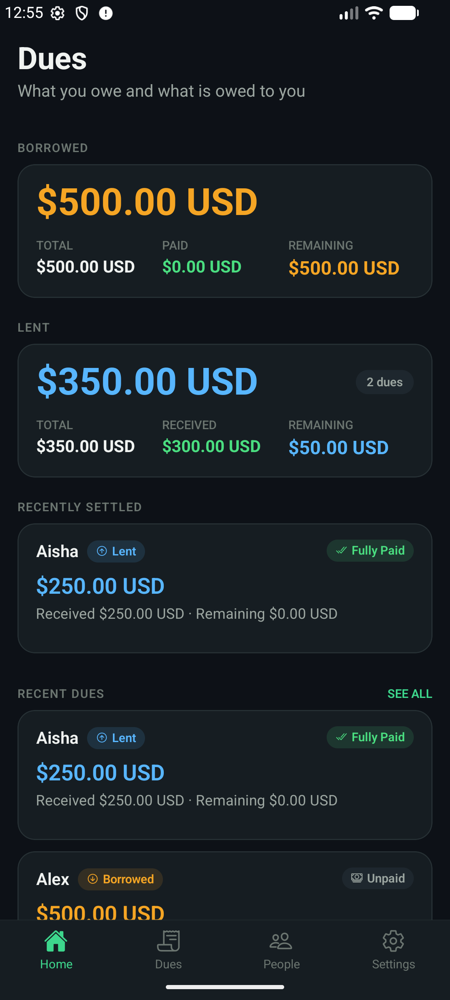
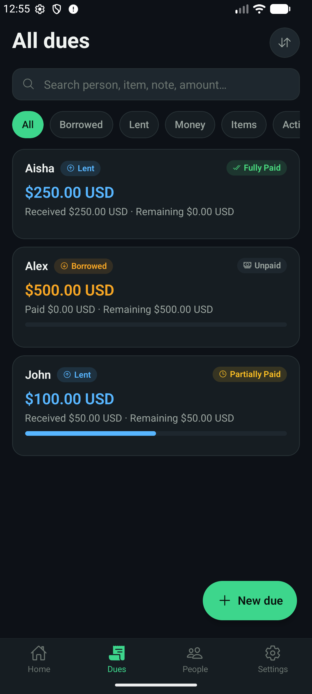
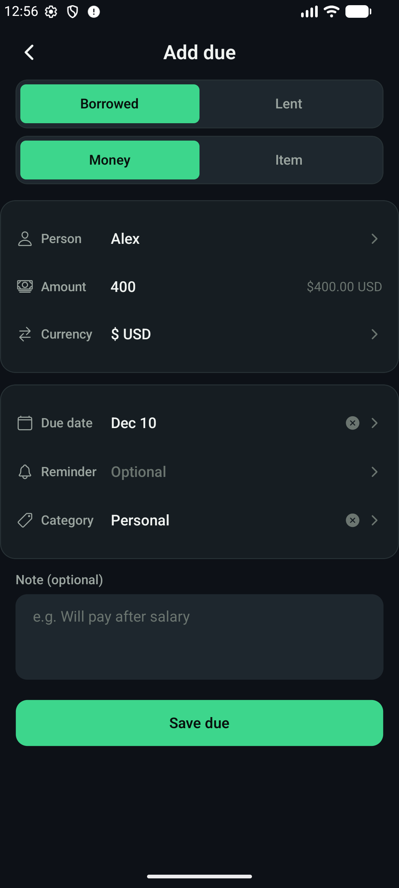
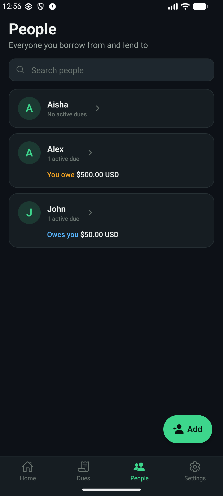
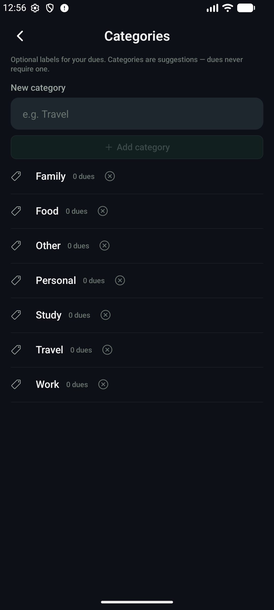
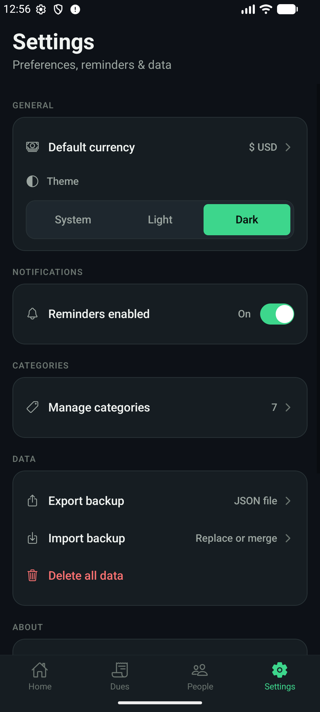

# Dues

A local-first tracker for money and things you **borrow** or **lend** — built with React Native, Expo SDK 54 and TypeScript.

Simple by design: no account, no backend, no internet. Open it, add a due, and you're done. Everything stays on your device.

## Screenshots

| Dashboard | All Dues | Add Due |
| :---: | :---: | :---: |
|  |  |  |

| People | Categories | Settings |
| :---: | :---: | :---: |
|  |  |  |

## Features

- **Money dues** — partial payments with full history
- **Item dues** — optional quantity or status tracking
- **160+ currencies** with correct symbols and decimal precision
- **Per-entry currency freeze** — changing defaults never rewrites existing dues
- **Dashboard** grouped by currency with per-person outstanding totals
- **Filters & sorting** — 12 filters, 7 sort modes
- **Reminders** — daily / weekly / monthly / custom
- **Due dates & overdue** detection
- **Archive**, delete-with-undo, backup export/import
- **Light / Dark / System theme**

## Build & run

```bash
npm install
npx expo run:android --variant release   # local APK
```

`npm run typecheck` for TypeScript validation.

## Privacy

Everything stays on the device. No push tokens, no server, no analytics. Back up regularly via **Settings → Data → Export**.
